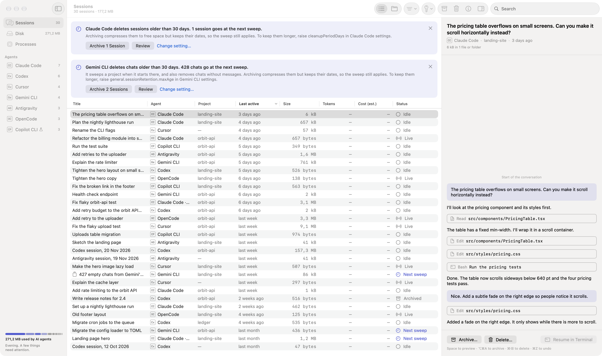
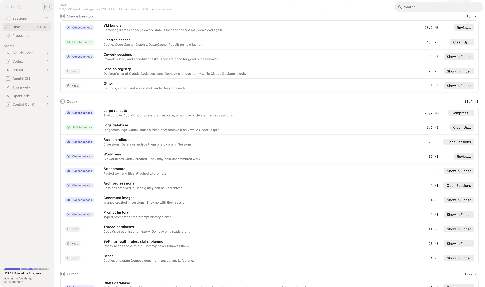
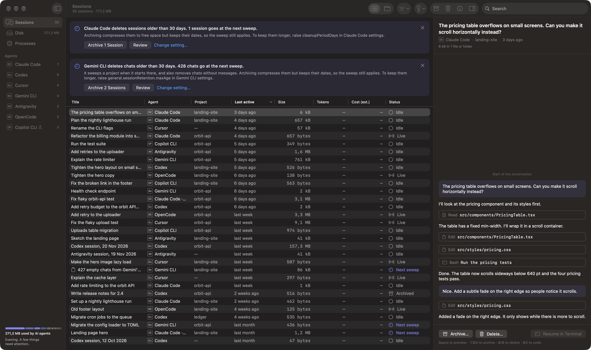
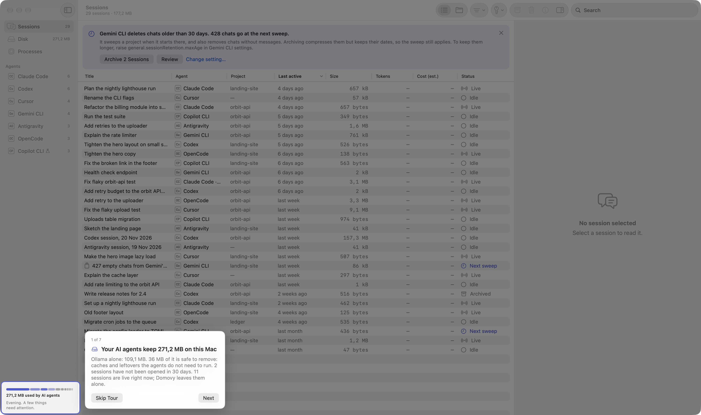
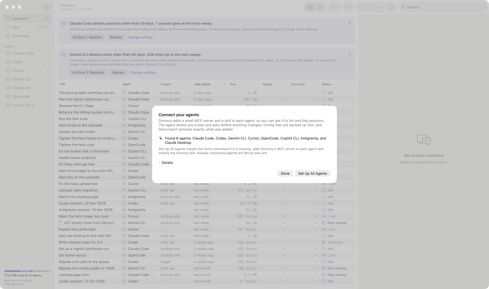
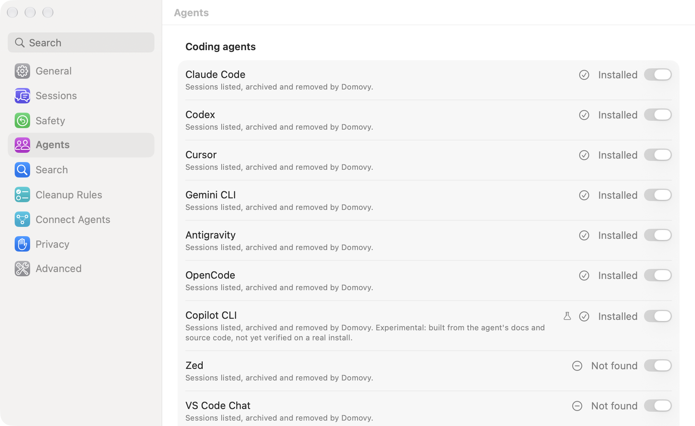

# Domovy

**Tidy up after your AI coding agents.**

A free, open-source, native macOS app (and `domo` CLI) that finds every AI agent session on your Mac, archives the ones worth keeping, deletes the rest properly, and shows where the disk space went.

Native Swift · Offline · No telemetry · Nothing deleted permanently by default

[](https://github.com/turman17/Domovy/releases/latest)
[](https://github.com/turman17/Domovy/releases)
[](LICENSE)
[](https://github.com/turman17/Domovy/releases/latest)

**[Download](https://github.com/turman17/Domovy/releases/latest)**



| Disk | Dark mode |
|---|---|
|  |  |

*Domovy* (домовий) is the Ukrainian house spirit who quietly keeps the home in order.

## Why

AI agents write a lot to disk and rarely clean up. A Claude Code session is spread over five to ten places; Codex keeps rollouts plus several SQLite indexes; Cursor keeps chats inside one shared database. None of them has a proper "delete this session", and some delete your history on their own after 30 days without a warning. Domovy understands each agent's storage and does the tidying for you, carefully.

## What it does

- **Sessions.** One table of every session across agents: title, agent, project, last active, size, status (live, idle, archived, expiring). Search, filters and a native transcript preview (Space).
- **Delete properly.** Removes a session together with its companion files and index entries (Claude Desktop registry, Codex SQLite, Cursor rows), so nothing is left dangling. Every delete shows its plan first.
- **Archive.** Compresses cold sessions with APFS transparent compression; the agent can still resume them.
- **Retention warnings.** "Claude Code will delete 12 sessions in 4 days", with Archive all.
- **Secret scan.** Finds API keys and tokens in transcripts, locally, and redacts them.
- **Disk.** Per-agent breakdown, every category marked safe to remove, removable with consequences (explained), or keep. Guided cleanups for the Claude Desktop VM bundle, huge Codex rollouts, merged worktrees, local models (Ollama, LM Studio, Hugging Face).
- **Processes.** Per-session memory and CPU, orphaned agent processes and MCP servers, freeze instead of kill.
- **Rules.** Optional automatic tidying ("archive Codex sessions older than 60 days"), always previewed.
- **Menu bar.** Total agent footprint and anything that needs attention.
- **For agents too.** `domo` is an MCP server and an agent skill, so your agents can list and tidy their own sessions — with your approval of every plan.

## Supported agents

Every adapter reads the agent's storage format exactly; when it meets a layout or version it does not know, it goes read-only and says why. Agents marked *experimental* are built from the agent's documentation and source code but not yet checked against a real install; Domovy shows them with a flask badge.

| | Verified on a real install | Experimental (built from source, not yet verified) |
|---|---|---|
| **Sessions** (list, preview, delete, archive) | Claude Code, Codex (CLI and app), Gemini CLI, Antigravity CLI, OpenCode, Cursor (`state.vscdb` and CLI chats), Zed Agent Panel, VS Code chat (Copilot Chat), Gemini Code Assist | Copilot CLI, Qwen Code, Kimi CLI, Roo Code, Cline, Kilo Code, Crush, Continue, Auggie, Factory Droid, Aider, Grok CLI |
| **Sessions, read-only** | | Kiro, Goose, Amazon Q CLI |
| **Registry and disk** | Claude Desktop (session registry, VM bundle, caches) | |
| **Disk only** | Herdr | Windsurf, Trae, Warp, Amp, Junie, iFlow CLI |
| **Local models** | Ollama, Hugging Face cache | LM Studio |

Storage details, sources and what was verified are in [docs/research/agent_storage_formats.md](docs/research/agent_storage_formats.md). If you use an experimental agent, a report that it works (or does not) is very welcome.

## Install

```bash
brew trust turman17/tap
brew install --cask turman17/tap/domovy
xattr -dr com.apple.quarantine /Applications/Domovy.app
```

Or download `Domovy-v<version>.zip` from [Releases](https://github.com/turman17/Domovy/releases), move `Domovy.app` to `/Applications`, and run the same `xattr` command. The cask also puts `domo` on your `PATH`; with the zip, the app offers to install it (Domovy > Connect Agents…).

> **Why `brew trust`?** Recent Homebrew versions load casks from third-party taps only after you trust the tap once. Older versions don't have the command and don't need it.
>
> **Why the `xattr` step?** Domovy is open source but not notarized (no paid Apple Developer account), so Gatekeeper blocks the first launch. Clearing the quarantine flag once fixes it — or approve the app under System Settings → Privacy & Security → "Open Anyway". Builds are signed with a stable identity, so permissions you grant survive updates.

### First run

1. Launch Domovy. The welcome explains what it reads and what it never does.
2. Take the short tour (Help > Take the Tour plays it again).
3. Optional: connect your agents (last welcome step, or Domovy > Connect Agents…).
4. Optional: Full Disk Access (System Settings > Privacy & Security > Full Disk Access). Domovy works without it; with it, it can also measure the few agents that keep data in folders macOS protects.



## The `domo` CLI

The same engine as the app, for scripts and terminals:

```bash
domo ls                              # every session; --json for scripts
domo du                              # disk use per agent
domo rm --older 30d --agent codex --dry-run
domo archive a1b2c3d4
domo undo                            # put the last change back
domo --help
```

`rm` and `archive` always plan first: live sessions and sessions written to in the last 10 minutes are left alone, `--dry-run` prints the plan and its digest, and `-y --if-plan <digest>` runs exactly that plan.

### Connect your agents (MCP server and skill)

```bash
domo install           # pick agents; registers the MCP server and installs the domovy skill
domo connect --all --dry-run
domo disconnect --all  # removes exactly what was added
```

`domo install` uses the agent's own `mcp add` command where one exists (Claude Code, Codex, Gemini CLI, Qwen Code, Copilot CLI, Kimi CLI) and otherwise edits its config in place, keeping every other byte and backing the file up first. Agents can then list sessions and disk use and plan deletes and archives; a change runs only with the token of a plan the agent showed you. After upgrading, `domo update` refreshes the skill. Formats and sources: [docs/research/mcp_skill_install.md](docs/research/mcp_skill_install.md).

| Connect Agents | Settings |
|---|---|
|  |  |

## Safety promises

1. **Nothing is deleted permanently by default.** Removed files go to the Trash or to Domovy's quarantine folder, and every change writes an undo entry.
2. **Every change is a plan.** You see exactly which files and index entries change, and how much space comes back, before anything happens.
3. **Live sessions are never touched.** Domovy checks open files, the agents' own session markers and lock files; if unsure, it refuses.
4. **The agent's own command comes first** (`codex delete`, `opencode session delete`, `ollama rm`, `hf cache rm`), and the result is checked afterwards.
5. **No database is written while its app runs.** Databases are backed up before any write.
6. **Modification times are preserved**, so agents' own retention keeps working as before.
7. **What agents need to run is never removed**: settings, auth, plugins, skills, memory, `CLAUDE.md`.

The quarantine and undo log live in `~/Library/Application Support/Domovy`. Uninstalling, even with `brew uninstall --zap`, leaves that folder alone.

## Privacy

- **No network.** Domovy makes no network connections: no update checks, no analytics, no crash reporting.
- **No telemetry.** Nothing about you or your sessions leaves your Mac.
- **Transcripts stay local.** They may contain secrets; Domovy reads them only to show and search them on your Mac, and never logs their content.
- **Read-only by default.** Domovy changes nothing until you approve a plan. Agent configuration changes only when you connect an agent.

## Building from source

Requirements: macOS 14+, Xcode 16+, Swift 6.

```bash
swift test                          # DomovyCore tests (fixture homes, never your real ~)
make run                            # Debug build against .devhome, a synthetic fake home
bash scripts/build-and-sign.sh      # Release build, signed; add --install to copy it to /Applications
```

Signing auto-detects an Apple Development certificate in your keychain (a stable identity keeps macOS permission grants across rebuilds) and falls back to ad-hoc; override with `SIGNING_IDENTITY`. Debug runs point `DOMOVY_ROOT` at `.devhome/`, so development never reads or changes your real home. Releases: see [RELEASING.md](RELEASING.md).

## Architecture

```
App/                 SwiftUI app: main window, MenuBarExtra, Settings
Sources/DomovyCore/  all logic, no UI imports
  Adapters/          one adapter per agent behind one protocol
  Safety/            live-session checks, plans, quarantine, undo log
  MCP/               the MCP server behind `domo mcp`
Sources/domo/        the CLI (swift-argument-parser)
Sources/CZstd/       vendored zstd, decompression only
Tests/               fixture homes per agent and version
```

## Contributing & support

Found a bug, or use an agent Domovy does not know yet? [Open an issue](https://github.com/turman17/Domovy/issues), and see [CONTRIBUTING.md](CONTRIBUTING.md). If Domovy keeps your house in order, **⭐ star the repo** — it's how other Mac users find it.

## License

Domovy is free software, licensed under the [GNU GPL v3.0](LICENSE).

Bundled third-party code:

- **zstd 1.5.7** — decompression of Codex and Zed files, BSD
- **swift-argument-parser** — the `domo` CLI, Apache-2.0

See [THIRD_PARTY_NOTICES.md](THIRD_PARTY_NOTICES.md) for full notices.
